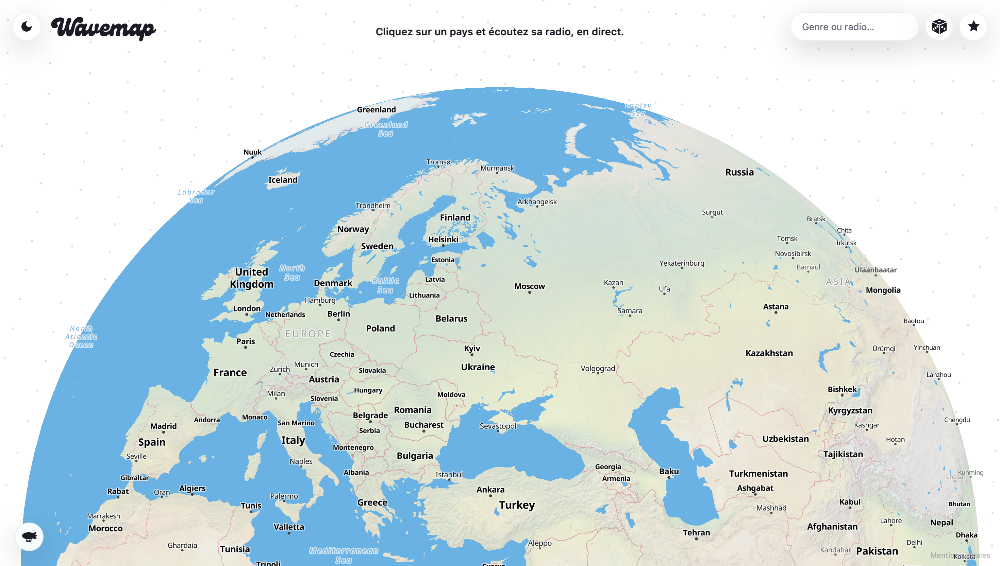
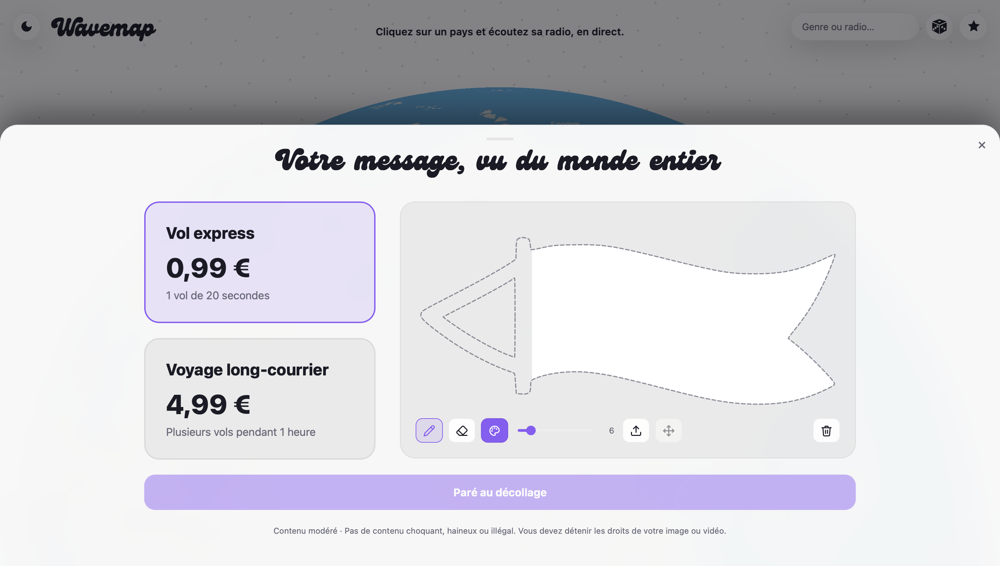
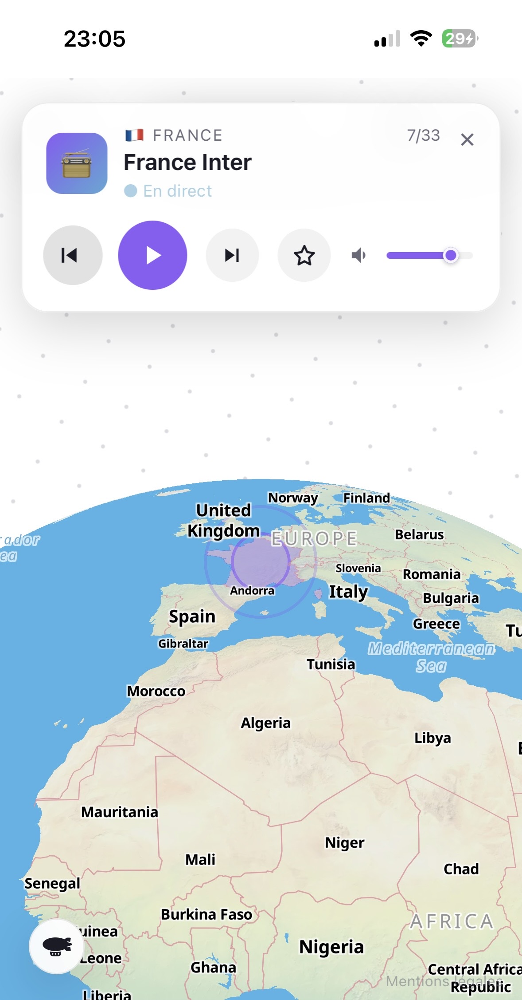

# Wavemap

**Click a country, listen to its radio live.**

Wavemap is an interactive globe that connects you to radio stations around the world. Explore the map, discover new sounds, and send your own message flying across the sky on a blimp, visible to every visitor.

🔗 **[wavemap.net](https://wavemap.net)**

---

<p align="center">
  
</p>

<p align="center">
  
  
</p>

---

## Features

- **Live radio**: click any country to stream a local station
- **3D globe**: smooth navigation on a MapLibre globe with spherical projection
- **Search**: find a country or a music genre instantly
- **Sky ads**: draw a message or upload an image or video, and fly it across the globe on a blimp, visible to all visitors in real time
- **Moderation**: every visual is checked automatically before it goes live
- **Payments**: Stripe Checkout, with prices set server-side and every payment verified by the server
- **Multilingual**: interface in 11 languages, detected automatically
- **Responsive**: works on desktop and mobile

## Tech stack

| Frontend | Backend | Services |
|----------|---------|----------|
| MapLibre GL | Node.js / Express | Stripe Checkout |
| HLS.js | Multer (uploads) | OpenAI Moderation |
| iro.js (color picker) | Persistent volume | Railway (hosting) |
| Vanilla JavaScript | | |

## Run locally

```bash
git clone https://github.com/NathanTessot75/wavemap.git
cd wavemap
npm install
cp .env.example .env   # then fill in your keys
npm start
# → http://localhost:5173
```

Payments and moderation need a Stripe test key and an OpenAI key. See [SETUP.md](SETUP.md) for the full setup, test cards and webhook configuration.

## How a sky ad works

1. The user draws or uploads a visual and clicks **Ready for take-off**.
2. The visual is sent to `/api/moderate` (OpenAI moderation); inappropriate content is rejected.
3. Otherwise a Stripe Checkout session is created and the user pays.
4. On return, the server verifies the payment (`/api/verify-session`, plus the Stripe webhook) and the visual appears on a blimp for everyone.

## License

© 2026 Nathan Tessot. All rights reserved.
